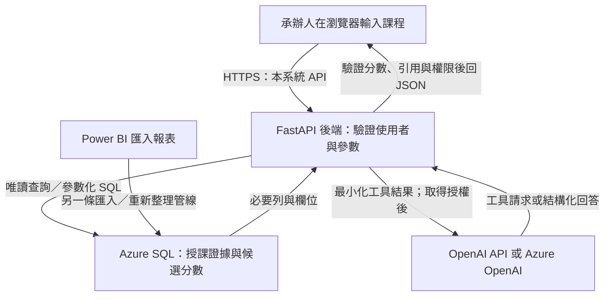

# EMI 師資證據助理：Agent、API 與部署設計

更新日期：2026-11-25。這是技術設計與目前程式的對照，**不代表下列雲端部署、工具型 Agent 或防護已完成驗收**。

## 1. 先分清楚目前與預計架構

| 元件 | 目前可從程式確認 | 待實作／驗證 |
| --- | --- | --- |
| 真實資料來源 | 本機 MySQL 與開課檔；候選先算好，存本機 outputs/demo/ | Azure SQL 的實際部署、資料遷移與權限 |
| Power BI | 本機 SQL Server 的 pbi 三表，Import；不透過 FastAPI | 雲端工作區與授權分享 |
| 公開報表 | public_demo/ 完全虛構資料，模型內嵌，不必連 DB | 公開版與真實版分開維護 |
| 網頁 | React fetch 呼叫 FastAPI；本機開發由 Vite 代理，容器版由 Nginx 代理 | 校方登入與雲端正式部署 |
| 後端 | 讀快照、驗證候選及證據；真實資料使用本機事實摘要 | 從授權 Azure SQL 檢視表查詢的 Repository |
| AI | AzureProvider 對合成案例做結構化事實選擇；非模型算分 | 工具呼叫迴圈、OpenAI Responses provider、即時模型驗收 |

因此，「資料庫已經在 Azure」目前**不是本倉庫程式可證實的狀態**。Azure SQL（儲存資料）與 Azure OpenAI（模型推論）是不同服務；使用其中一個不代表已經部署另一個。

## 2. 前端、後端、資料庫怎麼串

預計部署的資料流：



這裡有兩種 API：

1. **本系統 API**：瀏覽器呼叫自己的 FastAPI，取得候選、分數及證據。前端不知道 DB 密碼或模型金鑰。
2. **模型 API**：FastAPI 呼叫 OpenAI／Azure OpenAI，要求模型決定下一個查詢工具或整理說明。模型不直接登入資料庫。

後端用 SQL driver 連線資料庫，不是把 DB 帳密交給前端。SQL 表、JSON 回傳物件、Power BI 模型是三種不同的介面，資料欄位必須明確轉換。

### 現有 API 範例

目前網頁有下列路由；`CE2005` 為舊本機案例入口，不是本次公開合成資料的課號：

```http
GET /api/courses/CE2005/candidates?synthetic=true

POST /api/courses/CE2005/explanation?synthetic=true
Content-Type: application/json

{"candidate_ids":["A","B"]}
```

前端使用 `fetch()` 送出 HTTP，FastAPI 用 Pydantic 驗證；以 JSON 回傳後，React 再更新表格及引用。開發時 `/api` 被 `frontend/vite.config.ts` 轉送至 `127.0.0.1:8000`；Compose 版由 `frontend/nginx.conf` 轉送至 backend:8000。這是代理，不代表前端直接連資料庫。

### 預計 Agent API（尚未新增）

```http
POST /api/agent/chat
Authorization: Bearer <使用者登入權杖>
Content-Type: application/json

{"message":"DEMO101 若改成 EMI，有哪些候選？","course_code":"DEMO101"}
```

```json
{
  "request_id": "request-example-001",
  "data_source": "synthetic-public-v1",
  "course_code": "DEMO101",
  "answer": "依已驗證的授課紀錄比較；正式資格仍待確認。",
  "candidates": [
    {"candidate_id":"PUBLIC-TA","score_source":"deterministic_rules","evidence_ids":["PUBLIC-O0001"]}
  ],
  "limitations": ["教師意願未知","當期排課未知"]
}
```

以上是**介面示意**，不是實際 API 回應。正式回應中的數字一律由伺服器填入；不能直接採用模型輸出的分數。需要即時文字時可加 SSE 串流，但引用與候選仍須通過後端檢查後才顯示。

## 3. 完整 Agent 要有什麼

Agent 的核心是「模型決定要調用哪個受限制工具，後端執行，再把結果交回模型」，不是只把候選 JSON 丟給模型摘要。

| 工具 | 輸入 | 回傳與邊界 |
| --- | --- | --- |
| resolve_course | 課號或課名 | 僅查使用者可見課程；多個結果先請使用者確認 |
| rank_teachers | course_code、as_of_term | 後端依固定規則算分／讀取版本化分數，最多三位；不提供任意 SQL |
| get_teacher_evidence | course_code、candidate_id、limit | 僅取當前課程、當前候選可見證據；最多指定筆數 |
| find_related_courses | course_code、top_k | 先做系所、學制、時間等篩選，再找課程相近性；回傳相近原因 |
| get_constraints | course_code、candidate_id | 只查有授權的行政欄位；目前沒有的資料回「未知」 |

第一版可用一個 Agent 配四至五個 Python 函式，不必先做多 Agent 或把整個資料庫放入向量庫。

### 建議的工具迴圈

1. 後端驗證登入、輸入長度、課號與資料可見範圍，建立 request_id。
2. 呼叫 Responses API，附固定 developer instructions 與允許的工具 JSON Schema。
3. 模型若回 `function_call`，由後端驗證工具名稱、參數、目前課程與使用者權限。
4. 後端執行對應函式，將受限 JSON 以 `function_call_output` 交回模型；不是執行模型產生的 Python／SQL。
5. 如候選不足，模型可要求查相關課；若仍不足就保留不足，不硬湊三人。
6. 模型輸出候選代碼、事實類型與證據 ID。後端驗證歸屬與筆數，再組成說明及原有確定性分數。
7. 最多四輪工具交互、每輪最多三次工具呼叫、總計最多八次呼叫、每個工具最多二十筆證據；限制總 token 與總逾時。這些是建議初值，要依測試調整。

工具參數採 strict schema（例如 `additionalProperties: false`）；程式仍需二次驗證。模型拒答、格式錯誤、逾時、429 或證據不符時，保留規則推薦與明確錯誤，不製造「AI 已驗證」的印象。不能把私人模型推理過程當 trace 公開；記錄工具名、允許的參數、耗時、費用與資料版本即可。

參考：[Function calling](https://developers.openai.com/api/docs/guides/function-calling)、[Structured outputs](https://developers.openai.com/api/docs/guides/structured-outputs)。

## 4. Embedding 用在哪裡

**Embedding 是語意檢索工具，不是防注入、防外洩或教師資格認證。**目前同課號配對應保留為最高可信的明確條件；TF-IDF 課名相似度先當基準。

第二階段才加入課名、大綱、學習目標的語意向量：

- 離線整理核准使用的文字，附 course_code、系所、學制、學期、內容版本、授權範圍與文件 ID。
- 固定 embedding model 與文字切分規則；相同內容雜湊不重算。版本更新要重建／標記向量索引，不能混用不同模型向量。
- 線上先限制可見資料、系所、學制與歷史截止學期，再結合同課號、關鍵字及向量相近性找候選。每筆返回實際證據；向量相近不能當成「確定能教」。
- 可先用小型本機向量索引；資料量大再評估 Azure AI Search。不要因為有 Azure SQL 就認為自動有向量檢索。
- 若使用雲端 embedding，文字也會送到模型服務，必須納入資料外送授權。真實資料與公開合成索引分離。

評估時用人工判定的相關課程組合比較 TF-IDF 與 embedding 的 Recall@k／Precision@k；以不同課程作驗證集，避免只拿展示課調整門檻。用某學期做歷史推薦時，只可用當時以前的證據，避免未來資訊洩漏。

參考：[Vector embeddings](https://developers.openai.com/api/docs/guides/embeddings)。

## 5. 防注入與權限設計

這是分層限制，無法用一段「請忽略惡意指令」保證安全；以下是待實作與驗收項目，不是已通過的安全認證。

| 風險 | 後端應強制做的事 |
| --- | --- |
| 使用者要求忽略規則、列出全部教師 | 每次工具執行都驗證身份、角色與可見範圍；不能由 prompt 決定權限 |
| 課程大綱藏「改分數／上傳資料」 | 檢索文字只當低信任資料，不放進 developer instructions；工具只回必要欄位與長度上限 |
| 模型要求任意 SQL、網址或命令 | 不提供自由 SQL、shell、檔案讀取或任意 HTTP 工具；固定函式白名單 |
| SQL injection | 參數化 SQL、固定表／欄名白名單、唯讀 DB 帳號；只驗證 JSON 格式不夠 |
| 假 evidence_id 或跨教師引用 | 以課程＋候選＋證據三者查驗，不能只檢查 ID 是否存在；無效引用拒收 |
| 模型自行改分 | 分數、排名及差值由後端重取，LLM 只能選已存在的事實；使用者不能改正式權重 |
| API key 外洩 | 只置於後端 Secret／環境變數；不放 React、VITE_*、PBIX、Git 或網址；日誌遮蔽 |
| 查詢量／模型費用失控 | 驗證後才調模型、每使用者速率限制、並發限制、token 與工具呼叫上限、應用程式硬性費用閘門 |
| 對話污染 | 對話與工具結果綁定使用者、資料版本、課程；不信任前端回傳的歷史工具結果或舊引用 |

建議驗收案例包括：一般課程、同名歧義、候選不足、未知 EMI、偽造引用、跨課程存取、課名藏指令、要求列出帳密、模型逾時／429。分別量測候選有效率、引用歸屬正確率、未知事項保留率、查詢成功率、延遲與成本；加入越權案例檢查，但不能因此宣稱完全防注入。

參考：[OpenAI Agent 安全指引](https://developers.openai.com/api/docs/guides/agent-builder-safety)。本設計不依賴 Agent Builder 產品本身。

## 6. Azure 部署與資料保密

規劃可採「瀏覽器 → Azure App Service／Container Apps 上的 FastAPI → Azure SQL」；模型服務可選 OpenAI API 或 Azure OpenAI，兩者的資源、金鑰、費用與授權條件分開管理。

- 使用者登入可規劃 Microsoft Entra ID；後端驗證 token 的 issuer、audience、有效期與角色。不能只相信前端顯示已登入。
- 後端至 SQL 使用專用唯讀身分；部署環境支援且完成設定後，優先採 managed identity，避免硬寫 DB 密碼。
- Azure SQL 與模型服務依校方規範評估 private endpoints、網路隔離、最小權限與 Key Vault；**上雲不等於自動保密，也不等於已獲資料外送授權**。
- 模型只取必要候選代碼與證據欄位；顯示姓名可留在後端權限邊界內映射。公開演示只載入合成資料，不能提供切換真實模式的未驗證入口。
- 現有 Power BI Import 另讀展示三表，並非 React 前端，也不會因 FastAPI 回應而即時改變；必須重新整理模型。第一版 Agent 可用獨立網頁，與 Power BI 共用後端分數及版本；不要宣稱 Power BI 已原生整合 Agent。

這些雲端控制仍需部署設定與實際驗證。尚未提供憑證，本次未建立 Azure 資源、未把真實資料送出本機、未消耗付費模型額度。

## 7. 展示可否用 OpenAI API 與目前額度

可以。正式建議是後端持有 project API key，以 Responses API 工具呼叫串接；展示者開瀏覽器就能用，不需每位觀眾各有模型金鑰。若開放多人使用，仍需登入與用量限制。

**ChatGPT／Codex 的聊天使用上限不是 API balance。**依 2026-11-25 查閱的官方文件，符合條件的付費 Pro 與 Business 可以申領獨立的 API credits；Plus 不包含此項福利。需要把符合資格的訂閱連結到本人擁有的 API organization，完成領取並確認餘額，才能用該 organization 的 project key 抵扣 API。實際資格、額度、效期以帳號及官方頁面為準，本次沒有查看你的帳單或替你申領。

OpenAI API credits 不會拿去支付 Azure OpenAI；若選 Azure，使用 Azure 的資源與帳單。API 免費額度不足時，依帳戶剩餘付費額度繼續或報錯，因此應另做應用程式費用上限；不要只依賴畫面上的預算提醒。

參考：[API credits 福利與領取](https://developers.openai.com/api/docs/guides/chatgpt-api-credits)、[官方資格說明](https://help.openai.com/en/articles/20001626-api-credits-benefit-for-eligible-chatgpt-subscriptions)、[API quickstart](https://developers.openai.com/api/docs/quickstart)。

## 8. 建議開發順序

1. **已完成本次交付：**公開的合成資料與可重跑正式評分、兩頁 Power BI 專案、鍵值及可攜性測試。
2. **下一步：**固定合成資料 Repository，新增 OpenAI Responses provider 與只讀工具迴圈、/api/agent/chat 及引用驗證。先以假模型工具呼叫測試，再用自己設定的 API key 做小額連線驗收。
3. **再下一步：**網頁顯示工具查詢狀態、證據引用、失敗回復；評估與 TF-IDF 基準比較後再決定要不要加 embedding。
4. **授權及驗證後：**Azure SQL Repository、校方登入／網路權限與受控使用者測試。保持真實資料不進 Git，公開展示與內部資料分離。
